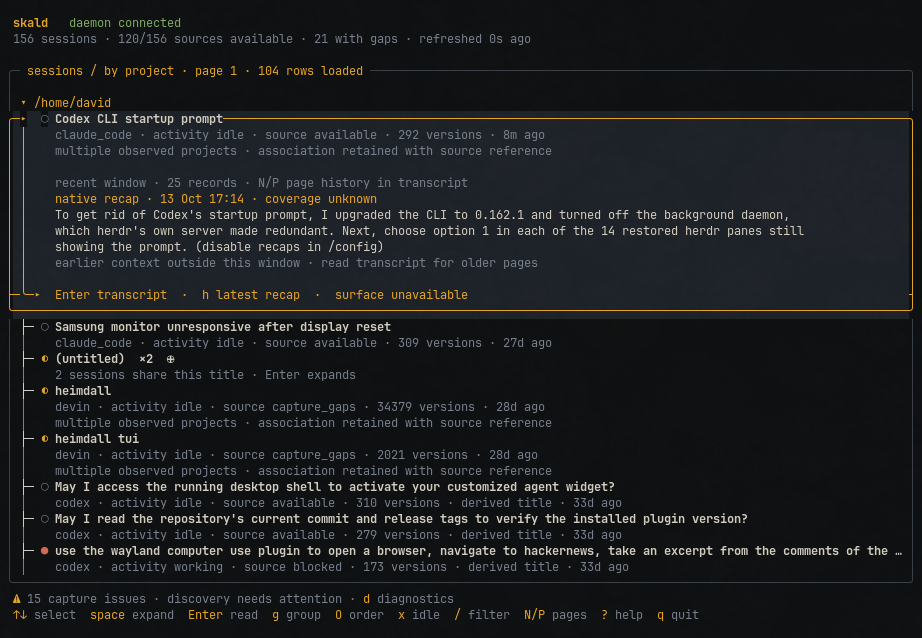

# Skald

An archive of Claude Code, Codex and Devin conversations, kept with exact provenance so past context can be found and trusted.

Conversations are scattered across tools and can be rewritten or deleted. Skald keeps selected source bytes alongside normalized records, exposes gaps and rewrites, and serves exact reads through a terminal UI, CLI and scoped read-only MCP server. Capture does not install provider hooks.

**Evidence:** [archive tests](internal/archive/), [capture tests](sessioncapture/) and [recorded verification](STATUS.md) · session-list p95 of 49 ms over 20,000 synthetic records ([measurement](docs/ARCHIVE-BENCHMARK.json)).

**Part of:** the agent runtime alongside [Heimdall](https://github.com/algorhythmic/heimdall), [Braid](https://github.com/algorhythmic/braid) and [Wayland Computer Use](https://github.com/algorhythmic/wayland-computer-use). Heimdall uses Skald's capture library; Skald can optionally use a pinned Braid executable for scoped lexical retrieval.

[](docs/images/skald-tui.png)

*Browse conversations by project, inspect session recaps, and see source availability. Select the screenshot to view it at full size.*

## Quick start

Needs Linux and Go with support for the pinned 1.27.1 toolchain.

```sh
git clone https://github.com/algorhythmic/skald.git && cd skald
make build
./bin/skald sources --provider claude_code  # preview sources
./bin/skald connect --provider claude_code  # select a source for capture
./bin/skald                                # daemon and terminal UI
```

## Status and limits

Local archive, browsing, exact reads, read-only MCP, backup and restore work on Linux. Claude Code child transcripts can be enabled per root. Provider support is checked against samples, not every version. Optional pinned Braid retrieval, whole-archive descriptions and bounded storage maintenance are available. Other provider subagents and portable exports remain planned; browser/cloud conversations are not covered. The latency result is a small local benchmark; storage growth remains a release concern. [Full status](STATUS.md).

---

## Detailed overview

Skald provides an overview of conversation context across projects, terminals,
desktop apps and other supported environments. Skald owns conversation capture,
archive preservation and standalone browsing. Its reusable packages preserve
source identity and provenance without owning accepted task state. The proposed
Odin integration retains this standalone product and places commitment authority
in Odin after a separately gated Heimdall migration; no task cutover is implemented
by Skald. See the [producer integration plan](docs/ODIN-INTEGRATION-PLAN.md).

The archive daemon, CLI and native terminal UI are runnable on Linux. They retain
selected Claude Code and Codex transcripts and Devin desktop session stores
independently and support exact
reads, backup and restore. Browse project groups, excerpts, recaps and transcript
history with `skald tui`. See [TUI usage](docs/TUI.md),
[archive setup](docs/ARCHIVE-SETUP.md) and [implementation status](STATUS.md).

- [Connect real conversation sources](docs/SOURCES.md)
- [Give agents scoped MCP reads](docs/AGENT-READS.md)
- [2026-10-22 implementation and remaining acceptance gates](docs/COMPLETION-IMPLEMENTATION-2026-10-22.md)
- [Create and verify a local producer candidate](docs/producer-bundle.md)
- [Implementation plan](SKALD-IMPLEMENTATION-PLAN.md)
- [Odin integration: scope, first batch and producer release gates](docs/ODIN-INTEGRATION-PLAN.md)
- [Heimdall amendment — historical consumer policy](SKALD-HEIMDALL-AMENDMENT.md)
- [Session overview design](skald-window.html) and [transcript design](skald-transcript.html)
- [Record and checkpoint contract](docs/CONTRACT-V1.md)

## Build and run

Use Go with support for the pinned 1.27.1 toolchain. Make automatically uses
`.tools/go/bin/go` when present, otherwise `go` from PATH. You can also pass
`GO=/absolute/path/to/go`. The optional local toolchain and default build/module
caches under `.cache/` are ignored by version control. From this project:

```sh
make build
./bin/skald version
./bin/skald serve --config examples/fixture-sources.json
```

To connect real local conversations, preview and save your chosen sources:

```sh
./bin/skald sources --provider claude_code
./bin/skald sources --provider codex
./bin/skald sources --provider devin
./bin/skald connect --provider claude_code
./bin/skald connect --provider codex --max-sessions 128
./bin/skald connect --provider devin
./bin/skald serve
```

The saved roots are monitored for new conversations. See [source connection](docs/SOURCES.md)
for scope, capacity, and metadata-only previews. Stop the synthetic daemon before
starting the real one on the default socket, or use separate socket/data paths.

In another terminal:

```sh
./bin/skald tui
./bin/skald status
./bin/skald sessions
```

Once a configuration is saved, plain `./bin/skald` starts the daemon when the
socket has no live peer and then opens the TUI.

For a temporary synthetic demonstration, run `make demo` in a terminal.
Skald uses heimdall’s dark palette by default; press `t` to cycle through the
terminal (`desktop`) and original `amber` palettes, or start with
`skald tui --theme desktop`.

Read-only capture diagnostics remain available without the daemon:

```sh
./bin/skald probe --provider codex --provider-version 0.153.4
./bin/skald inspect --provider claude_code --namespace fixture:claude \
  --stream-id fixture-claude --file testdata/claude/session.jsonl
./bin/skald inspect --provider codex --namespace fixture:codex \
  --stream-id fixture-codex --file testdata/codex/session.jsonl
```

`inspect` is read-only. It prints normalized records, explicit gaps and a candidate
checkpoint; `--raw` also includes exact source bytes as base64. `--limit` bounds
records per invocation. To resume, save the `checkpoint` object from the batch to
its own file and pass `--checkpoint FILE`. Durable consumers must commit originals,
records, gaps and the checkpoint together; the inspection CLI does not do that.

`discover --root DIRECTORY` lists JSONL files only under a chosen root without
following nested symlinks. It does not ingest them. `probe` reports compatibility
with fixture-tested provider versions, not proof that a live application works.
Collection uses only your explicit configuration, including any discovery roots
you choose with `connect`. No provider hooks, user services
or desktop settings are installed.

## Verify

```sh
make check
```

This runs Go contract/capture/CLI tests, independent JSON Schema validation,
SQLite DDL checks (Python 3 standard library), and Go vet. `make build` produces
`bin/skald`. `make smoke` verifies the compiled daemon with temporary synthetic
sources and a real private Unix socket. Override `GO=/absolute/path/to/go` when Go is not on PATH.

All checked-in conversation fixtures are synthetic. Tests do not open personal
transcripts, contact Heimdall or make summarization/embedding requests.


## Compatibility and validation details

**Works with:** Claude Code, Codex (CLI and desktop) and Devin desktop as conversation sources. Read-only local samples confirmed the Claude Code 2.1.263 and Codex 0.153.4 primary file formats and 13 Devin desktop session stores. Native Claude child identity was also inspected in 2.1.296 and 2.1.303 samples. Agents can use nine [MCP read tools](docs/AGENT-READS.md) within explicitly granted namespaces.

- **Works today (Linux):** sole-writer archive daemon, source connection for Claude Code, Codex and Devin desktop, opt-in Claude child capture with native parent links, backfill and tailing with explicit gaps, terminal browsing, scoped MCP reads, exact historical reads, and online backup with fresh-directory restore.
- **Optional retrieval:** a configured, checksum-pinned Braid executable searches current archived user/assistant context within explicit namespaces and byte budgets; returned context includes exact citations. Retrieval is disabled by default.
- **Storage and descriptions:** whole-archive native recap/assistant selection, bounded payload compression, offline compaction and explicit recovery preview/apply policies. See [setup](docs/ARCHIVE-SETUP.md) and [recovery operations](docs/recovery-maintenance.md).
- **Planned:** tagged producer publication and Odin consumer pins/runtime acceptance; optional external task read enrichment; portable exports.
- **Not covered:** browser/cloud conversations, general provider subagent tracking, and general aliases across conversations. Bounded Codex fork ancestry is supported when native `forked_from_id` metadata proves the chain; see [source coverage](docs/SOURCES.md#codex-cli-and-forked-rollouts). Provider support is checked against samples, not proven complete.
- **What the numbers do not prove:** there is no CI workflow in this repository; recorded local checks do not close the full release gates. The latency figure is one small-record local run on warm caches and includes CLI start-up and socket transport. The same run stored 26.81× the source bytes, so storage growth on large transcripts is still a release concern.

Full detail: [STATUS.md](STATUS.md).

## License

[Apache License 2.0](LICENSE).
